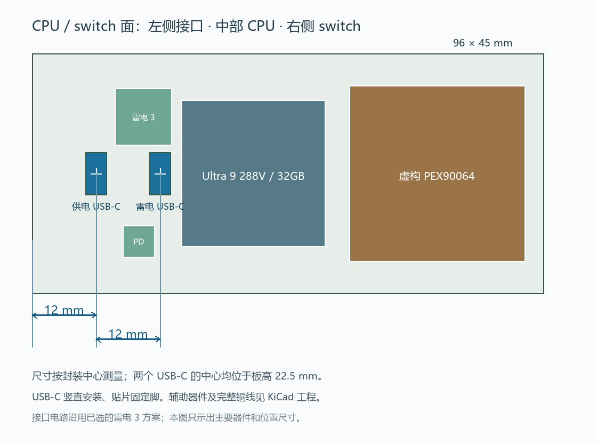

# PCIe switch PCB 设计草案

本仓库保存 KiCad 工程、封装、三维模型、生成及检查脚本，以及历次设计版本。

## 当前 E1.S 版本：Rev W

- [打开 KiCad 工程](outputs/PCIe_E1S_96x45_USB12mm_RevW/Main_12E1S/Main_12E1S.kicad_pro)
- [PCB 源文件](outputs/PCIe_E1S_96x45_USB12mm_RevW/Main_12E1S/Main_12E1S.kicad_pcb)
- [STEP 模型](outputs/PCIe_E1S_96x45_USB12mm_RevW/Main_12E1S/Main_12E1S.step)
- [设计说明与限制](outputs/PCIe_E1S_96x45_USB12mm_RevW/README.md)
- [当前重新审查](outputs/PCIe_E1S_96x45_USB12mm_RevW/rebuild_review_2026-10-18/README.md)

板框 96 × 45 mm，12 个竖直 E1.S 插槽，中心距 8 mm。按 CPU/switch 面看，主要顺序为左侧 USB-C、中部 CPU、右侧 switch；供电 USB-C 中心距左板边 12 mm，雷电口为 24 mm，两口中心距 12 mm，均位于板高 22.5 mm。

CPU 为 Ultra 9 288V / 32 GB 封装内存版本；switch 使用经授权虚构的 PEX90064 球位及 33 × 33 mm 封装。雷电电路仍采用雷电 3 主机口方案。32 层叠层和过孔结构是布局布线假设。

2026-10-18 的本地电气修订、验证结果与剩余问题见 [本轮审查](outputs/PCIe_E1S_96x45_USB12mm_RevW/ELECTRICAL_REVIEW_2026-10-18.md)。新增全焊盘检查发现旧电源报告仅覆盖选定焊盘，不能证明整网连通；历史报告不再作为当前板通过验证的依据。当前仍有未连接网络和跨层差分对，尚未完成电气与高速设计。已有 STEP 和预览图片尚未随本轮电气修改重新导出，只代表历史几何。

**该工程尚不能直接生产或上电。** 真实 CPU 动态供电、完整雷电内部供电和固件尚未完成，自定义供电 USB-C 尚未接入主输入。SSD 的 12 V / 300 W 是设计预算，不能当作已验证的载流额定值。虚构 switch 不能用于真实芯片贴装；PCIe/雷电信号完整性、阻抗、热、时序与制造要求尚未验证。

当前 E1.S 从保留的第一轮源重新审查，先前未推送的后续本地快照已丢失，不能视为仓库成果。最新源 SHA 和审计入口见 CURRENT_DESIGNS.json。

## 独立全 M.2 版本

[Rev P / Main_20M2](outputs/PCIe_AllM2_RevP/Main_20M2/Main_20M2.kicad_pro)：120 × 45 mm、20 个 M.2 插槽、中心距 6 mm。其具体实现程度与限制见该版本说明，不能将其与 Rev W 的检查结果混用。

## 目录与使用

- `CURRENT_DESIGNS.json`：当前设计入口和版本信息。
- `outputs/`：KiCad 源文件、项目内封装/符号/模型、检查报告及历次版本。
- `scripts/`：各版本的生成、调整、路由与检查脚本。

用本机 KiCad 10 打开对应 `.kicad_pro`。STEP 模型和工程内库随各版本保存。生成脚本记录了本机工作路径，部分路由脚本还依赖 NumPy、SciPy 和未提交的中间文件；它们不是跨平台的一键构建系统。

下载的厂家数据手册、原始设计套件、工作目录、压缩包和本机 CAD 自动导入文件不在公共提交范围。所需的资料来源与器件参考链接见各版本设计说明；PCB 草案不依赖随仓库分发这些原始下载文件才能在 KiCad 中打开。
